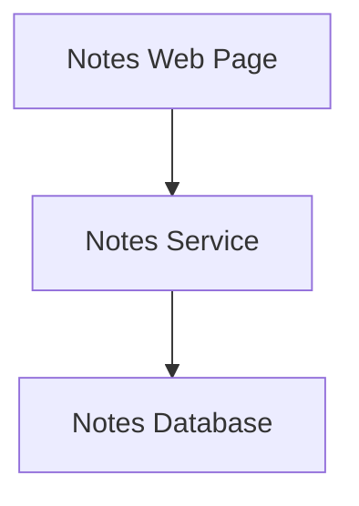
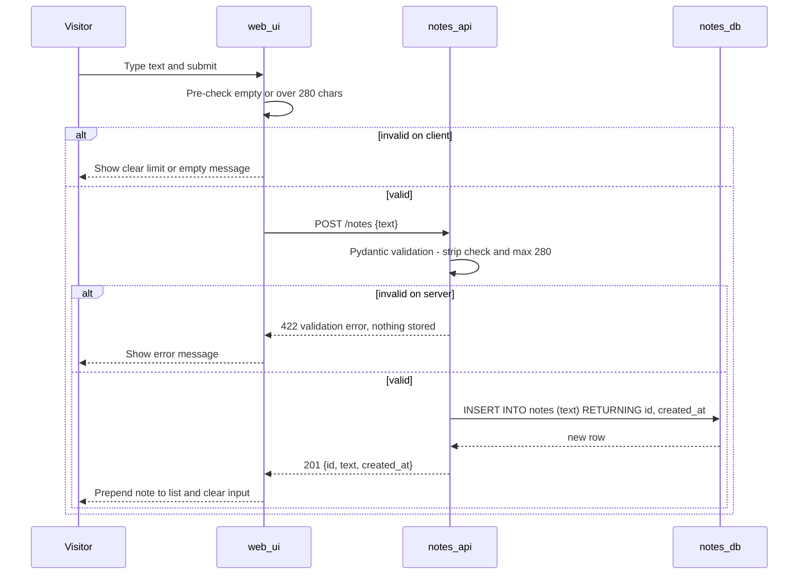
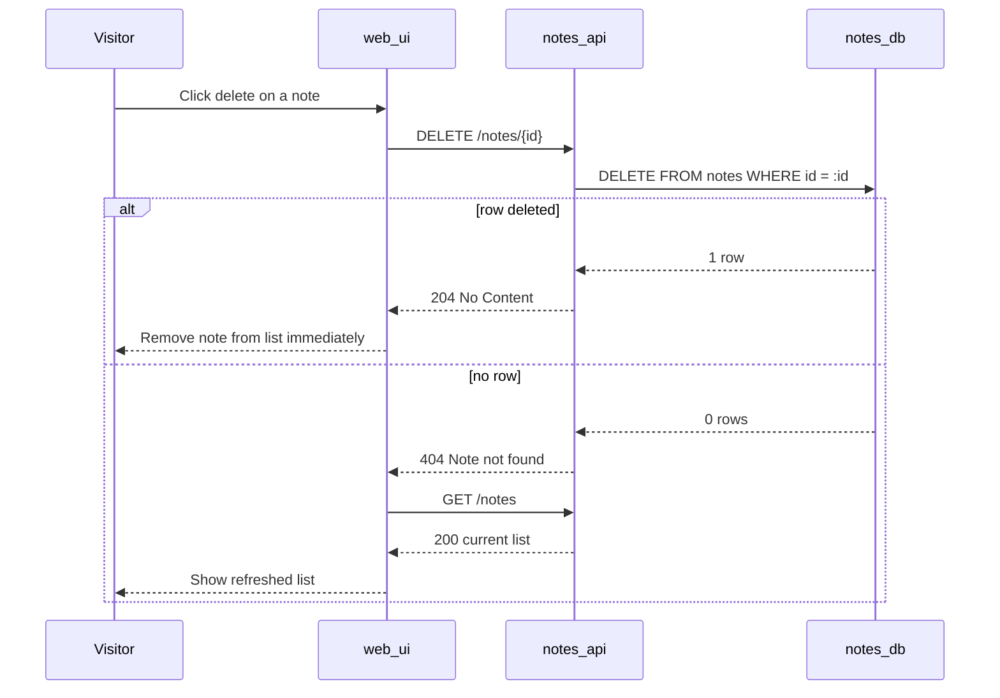
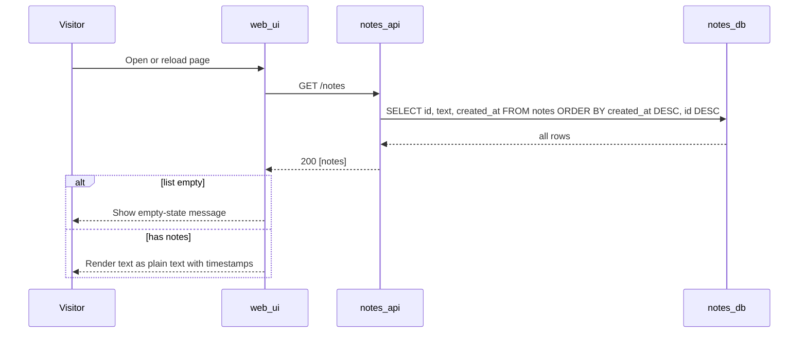
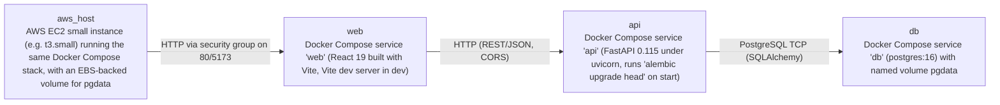

# Architecture

> Maintained by QuorQ AI SDLC. Text between `sdlc:auto` markers is regenerated; anything outside them is yours and is kept.

<!-- sdlc:auto:start narrative -->
## Overview

### ARCH-OVERVIEW · approved · source: architecture:summary

Notes A is a single-page shared notes board with no login. Visitors can add a plain-text note of up to 280 characters, see all notes newest first with timestamps, and permanently delete any note. The architecture is three parts: React SPA, FastAPI REST service and PostgreSQL. All three run under Docker Compose.

- Status: approved. Version: 1.
- Product scope:
  - Shared board.
  - Plain-text notes of up to 280 characters.
  - Listed newest first with timestamp.
  - Permanent delete of any note.
  - No login.
- Frontend: React 19 single page built with Vite.
- Backend: FastAPI 0.115 REST service exposing GET, POST and DELETE on /notes.
- Storage: one PostgreSQL 16 table, created through Alembic migrations, accessed through SQLAlchemy.
- Validation:
  - Server-side through Pydantic.
  - Backed up by a database CHECK constraint.
- Output safety: React renders note text as text nodes, so markup is never interpreted.
- Runtime: all three parts run as Docker Compose services, both on a developer machine and on one small AWS EC2 instance.
- Persistence: a named volume keeps notes across restarts.
- Constraints: no external services, API keys, caches or extra libraries.

**Related:** ARCH-COMP-WEB_UI, ARCH-COMP-NOTES_API, ARCH-COMP-NOTES_DB, ARCH-DEPLOY, ARCH-TECH-FRONTEND, ARCH-TECH-BACKEND, ARCH-TECH-DATABASE, ARCH-TECH-CLOUD

- ⚠ No approval date or approver is recorded for this architecture version.
- ⚠ The architecture cites AC-xxx and NFR-xxx ids, but the known requirement keys are US-001 to US-009. No mapping between them was provided, so links to the US keys cannot be established.

### ARCH-COMP-WEB_UI · approved · source: architecture:components:web_ui

Notes Web Page: the React 19 single page (built with Vite, served as static assets). It lists notes, provides the add form with a 280-character counter, and offers one-click delete. Note text is rendered only as React text nodes.

- Technology: React 19, built with Vite, served as static assets.
- List:
  - Shows all notes newest first, each with its timestamp.
  - Shows an empty-state message when there are no notes.
- Add-note form:
  - 280-character counter.
  - Clear messages for empty text and for text that is too long.
- Delete:
  - One click.
  - No confirmation.
- List updates:
  - Updates immediately after an add or delete.
  - Re-fetches the list if a delete returns 404.
- Rendering safety: note text is rendered only as React text nodes; dangerouslySetInnerHTML is not used.
- No edit control is offered.
- Structure (from the Frontend tech decision): three components, NoteForm, NoteList and NoteItem.
- Uses the native fetch API, and Intl for timestamp formatting.

**Related:** ARCH-COMP-NOTES_API, ARCH-PATH-ADD, ARCH-PATH-DELETE, ARCH-PATH-LIST, ARCH-TECH-FRONTEND, NFR-001

- ⚠ The component says it is served as static assets, but the 'web' deployment node describes a Node 20 container on port 5173 running the Vite dev server in dev. How static assets are served in the AWS deployment is not specified.

### ARCH-COMP-NOTES_API · approved · source: architecture:components:notes_api

Notes Service: a FastAPI 0.115 REST API with SQLAlchemy and Alembic. It supports list, create and hard-delete operations, with server-side validation. It has no auth, no rate limiting and no update route.

- Technology: FastAPI 0.115, SQLAlchemy, Alembic.
- Operations:
  - GET /notes returns all notes newest first.
  - POST /notes creates a note.
  - DELETE /notes/{id} hard-deletes a note.
- Validation (server-side):
  - Text must not be empty or whitespace-only.
  - Text must be at most 280 characters.
  - Invalid input returns 422.
- Unknown ids return 404.
- No update route exists, so PUT/PATCH returns 405 or 404.
- No authentication and no rate limiting.
- CORS allows the web page origin.
- Alembic migrations run at container start.

**Related:** ARCH-COMP-NOTES_DB, ARCH-ENDPOINTS, ARCH-PATH-ADD, ARCH-PATH-DELETE, ARCH-PATH-LIST, ARCH-TECH-BACKEND, NFR-002

- ⚠ Inconsistent wording on PUT/PATCH: the component says '405 or 404', but the Backend tech decision says leaving out update routes 'gives 405'. Please confirm the expected status code.
- ⚠ No rate limiting or auth on a publicly hosted EC2 service is stated as a design choice. Any accepted abuse or spam risk is not documented.
- ⚠ The exact CORS origin(s) for local and AWS environments are not specified.

### ARCH-COMP-NOTES_DB · approved · source: architecture:components:notes_db

Notes Database: PostgreSQL 16 holding a single notes table. The table has a length CHECK constraint and a created_at index. Data is kept on a named Docker volume so it survives restarts.

- Technology: PostgreSQL 16.
- Schema: a single notes table.
- Length CHECK constraint, as defence in depth behind API validation.
- Index on created_at to support newest-first ordering.
- Persistence: data lives on a named Docker volume (pgdata) and survives container and Compose restarts.

**Related:** ARCH-ENTITY-NOTES, ARCH-COMP-NOTES_API, ARCH-TECH-DATABASE, NFR-003

- ⚠ The exact CHECK constraint expression is not specified, e.g. whether it also rejects whitespace-only text or only enforces length.
- ⚠ No backup or snapshot strategy is described for the database volume (local or EBS).

### ARCH-ENTITY-NOTES · approved · source: architecture:entities:notes

The single data entity is notes, with fields id, text and created_at.

- Entity: notes.
- Fields:
  - id
  - text
  - created_at
- Ordering used by the API: created_at DESC, then id DESC.
- Index on created_at.
- Length CHECK constraint on text (280-character maximum, per the validation rules).

**Related:** ARCH-COMP-NOTES_DB

- ⚠ Column types are not specified (e.g. id integer/serial vs UUID; created_at timestamp with or without time zone).
- ⚠ It is not stated whether created_at is set by the database default or by the application.

### ARCH-ENDPOINTS · approved · source: architecture:endpoints

Four HTTP endpoints: list notes, create note, delete note and a health check. There is no pagination and no update endpoint.

- GET /notes:
  - Lists all notes, newest first.
  - No pagination.
- POST /notes:
  - Creates a note of 1 to 280 characters that is not whitespace-only.
  - Returns 201 on success and 422 for invalid input.
- DELETE /notes/{id}:
  - Permanently deletes any note (hard delete, no ownership check).
  - Returns 204 on success and 404 for an unknown id.
- GET /health:
  - Liveness check.
  - Used by the Docker Compose healthcheck and the README.
- PUT/PATCH: not implemented (405 or 404; see the ARCH-COMP-NOTES_API gap).

**Related:** ARCH-COMP-NOTES_API, ARCH-PATH-ADD, ARCH-PATH-DELETE, ARCH-PATH-LIST, ARCH-DEPLOY

- ⚠ Response body shapes (JSON field names and the timestamp format) are not specified.

### ARCH-PATH-ADD · approved · source: architecture:critical_paths:add_note

Critical path for adding a note: the UI pre-checks the text and POSTs it, and the API re-validates it. On success the API inserts and returns 201, and the UI prepends the note. Invalid bodies return 422 and nothing is stored.

1. The visitor submits text.
2. The UI pre-checks the text so it can show a friendly message, then POSTs /notes.
3. The API validates again:
   - strips the text to check for emptiness;
   - requires len(text) <= 280.
4. On valid input, the API inserts the row and returns 201.
5. The UI prepends the note to the list and clears the input.
6. On an invalid body, the API returns 422 and stores nothing.
- Covers: AC-006, AC-008 to AC-011, NFR-002.

**Related:** ARCH-COMP-WEB_UI, ARCH-COMP-NOTES_API, AC-006, AC-008, AC-009, AC-010, AC-011, NFR-002

- ⚠ It is not stated whether the stored text is the raw input or the stripped text, or whether the 280 limit applies before or after stripping.

### ARCH-PATH-DELETE · approved · source: architecture:critical_paths:delete_note

Critical path for deleting a note: one click sends DELETE with no confirmation. A 204 removes the note immediately. A 404 (already deleted by someone else) triggers a silent list re-fetch without crashing.

1. The visitor clicks delete once; no confirmation is shown.
2. The UI sends DELETE /notes/{id}.
3. On 204, the note is removed from the list immediately.
4. On 404 (someone else already deleted it), the UI silently re-fetches the list and does not crash.
- Covers: AC-014 to AC-017, NFR-007, NFR-008.

**Related:** ARCH-COMP-WEB_UI, ARCH-COMP-NOTES_API, AC-014, AC-015, AC-016, AC-017, NFR-007, NFR-008

### ARCH-PATH-LIST · approved · source: architecture:critical_paths:list_notes

Critical path for listing notes newest first: the UI fetches all notes on page load. The API returns every row ordered by created_at DESC, id DESC, with no pagination. The UI renders literal text with a locale-formatted timestamp, or an empty-state message.

1. On page load, the UI fetches GET /notes.
2. The API returns every row ordered by created_at DESC, id DESC, with no pagination.
3. The UI renders each note's text as literal text, with a locale-formatted timestamp (Intl).
4. If the list is empty, the UI shows an empty-state message.
- Covers: AC-001 to AC-005, AC-007, AC-021.

**Related:** ARCH-COMP-WEB_UI, ARCH-COMP-NOTES_API, ARCH-COMP-NOTES_DB, AC-001, AC-002, AC-003, AC-004, AC-005, AC-007, AC-021, NFR-001

- ⚠ Behaviour when GET /notes fails (network or server error) is not described.

### ARCH-DEPLOY · approved · source: architecture:deployment_nodes

Three Docker Compose services (web, api, db) run identically on a developer machine and on a single small AWS EC2 instance. The pgdata volume is EBS-backed on AWS.

- web:
  - Docker Compose service 'web'.
  - React 19 built with Vite; Vite dev server in dev.
  - Node 20 container, port 5173.
- api:
  - Docker Compose service 'api'.
  - FastAPI 0.115 under uvicorn; runs 'alembic upgrade head' on start.
  - Python 3.12 container, port 8000.
- db:
  - Docker Compose service 'db' (postgres:16) with named volume pgdata.
  - PostgreSQL 16 container, port 5432, internal only.
- aws_host:
  - AWS EC2 small instance (e.g. t3.small) running the same Docker Compose stack.
  - EBS-backed volume for pgdata.
  - Amazon Linux with Docker and Docker Compose.
- Health: GET /health is used by the Compose healthcheck.

**Related:** ARCH-COMP-WEB_UI, ARCH-COMP-NOTES_API, ARCH-COMP-NOTES_DB, ARCH-TECH-CLOUD, NFR-003, NFR-009

- ⚠ The production web serving mode on EC2 is not specified (the Vite dev server is only described for dev; static asset serving is not described).
- ⚠ TLS/HTTPS, domain name and any reverse proxy for the EC2 host are not described.
- ⚠ Which ports are publicly exposed on EC2 (security group rules for 5173 and 8000) is not specified.
- ⚠ The instance size is given only as an example ('e.g. t3.small'); the final choice is not confirmed.

### ARCH-TECH-FRONTEND · approved · source: architecture:technology_decisions:frontend

Frontend choice: React 19 built with Vite, from the approved stack. Vue and Svelte were the listed alternatives. React's default text escaping satisfies the plain-text display requirement.

- Choice: React 19.
- Alternatives: Vue, Svelte.
- Rationale as stated:
  - It is the approved stack.
  - A single page with a form and a list is built from three components (NoteForm, NoteList, NoteItem).
  - It is built with Vite, as the requirements assume.
  - React escapes text nodes by default, which satisfies NFR-001 (plain-text display).
  - It uses the native fetch API and Intl for timestamps.

**Related:** ARCH-COMP-WEB_UI, NFR-001

### ARCH-TECH-BACKEND · approved · source: architecture:technology_decisions:backend

Backend choice: FastAPI 0.115, from the approved stack. Express and Django REST Framework were the listed alternatives. A Pydantic field validator enforces the text rules and returns 422 automatically.

- Choice: FastAPI 0.115.
- Alternatives: Express, Django REST Framework.
- Rationale as stated:
  - It is the approved stack.
  - A Pydantic model with a field validator enforces the 1 to 280 character, non-whitespace rule server-side and returns 422 automatically (NFR-002).
  - Leaving out update routes gives 405 for PUT/PATCH.
  - SQLAlchemy handles data access; Alembic handles migrations.

**Related:** ARCH-COMP-NOTES_API, NFR-002

- ⚠ This decision says PUT/PATCH gives 405, while the notes_api component says '405 or 404'. The discrepancy is flagged for confirmation.

### ARCH-TECH-DATABASE · approved · source: architecture:technology_decisions:database

Database choice: PostgreSQL 16, from the approved stack. SQLite and MySQL were the listed alternatives. It uses one table with a CHECK constraint and a created_at index, on a persistent volume.

- Choice: PostgreSQL 16.
- Alternatives: SQLite, MySQL.
- Rationale as stated:
  - It is the approved stack.
  - One notes table with a CHECK constraint as defence in depth.
  - A created_at index supports newest-first ordering.
  - Data sits on a persistent Docker volume (NFR-003).

**Related:** ARCH-COMP-NOTES_DB, ARCH-ENTITY-NOTES, NFR-003

### ARCH-TECH-CLOUD · approved · source: architecture:technology_decisions:cloud

Cloud choice: AWS, from the approved stack. Azure and GCP were the listed alternatives. A single small EC2 instance runs the same Docker Compose file used locally, matching the low-traffic assumption.

- Choice: AWS.
- Alternatives: Azure, GCP.
- Rationale as stated:
  - It is the approved stack.
  - A single small EC2 instance runs the same Docker Compose file used locally.
  - This matches the low-traffic assumption (NFR-009).

**Related:** ARCH-DEPLOY, NFR-009

### ARCH-GAPS · draft

Cross-cutting traceability gaps found while documenting the architecture phase. These are not decisions, only items needing human follow-up.

- Requirement keys provided for this project: US-001 to US-009.
- The architecture references a different set of ids:
  - AC-001 to AC-011, AC-014 to AC-017, AC-021;
  - NFR-001, NFR-002, NFR-003, NFR-007, NFR-008, NFR-009.
- No AC-to-US or NFR-to-US mapping was supplied.

**Related:** US-001, US-002, US-003, US-004, US-005, US-006, US-007, US-008, US-009

- ⚠ Map the AC-xxx and NFR-xxx ids to US-001 to US-009 so architecture entries can be traced to user stories.
- ⚠ AC-012, AC-013, AC-018, AC-019 and AC-020 are not referenced by any critical path. Confirm whether they exist and how the architecture covers them.
- ⚠ NFR-004, NFR-005 and NFR-006 are not referenced anywhere in the architecture. Confirm whether they exist and how they are addressed.
- ⚠ No approval date, approver or decision record is given for the 'approved' status of Version 1.
<!-- sdlc:auto:end narrative -->

<!-- sdlc:auto:start building-blocks -->
## Building Block View

| ID | Name | Technology | Responsibility | Depends on |
|---|---|---|---|---|
| web_ui | Notes Web Page | React 19 (built with Vite, served as static assets) | Single page that lists all notes newest first with timestamps and shows an empty-state message. It provides the add-note form with a 280-character counter and clear empty/too-long messages, and a one-click delete with no confirmation. It updates the list immediately after an add or delete, re-fetches the list on a 404 during delete, and renders note text only as React text nodes (no dangerouslySetInnerHTML). It offers no edit control. | notes_api |
| notes_api | Notes Service | FastAPI 0.115 with SQLAlchemy and Alembic | REST API with three operations: GET /notes returns all notes newest first, POST /notes creates a note, and DELETE /notes/{id} hard-deletes a note. It validates server-side that text is not empty or whitespace-only and is at most 280 characters, returning 422 otherwise. It returns 404 for unknown ids. No update route exists, so PUT/PATCH returns 405 or 404. There is no auth and no rate limiting. CORS allows the web page origin. Alembic migrations run at container start. | notes_db |
| notes_db | Notes Database | PostgreSQL 16 | Durable storage of notes in a single table, with a length CHECK constraint and an index on created_at for newest-first ordering. Data lives on a named Docker volume so it survives container and Compose restarts. | — |

<!-- sdlc:auto:end building-blocks -->

<!-- sdlc:auto:start runtime -->
## Runtime View

### Add a note

The visitor submits text. The UI pre-checks it so it can show a friendly message, then POSTs it. The API validates again: it strips the text to check for emptiness and requires len(text) <= 280. It inserts the row and returns 201. The UI prepends the note and clears the input. An invalid body returns 422 and stores nothing (AC-006, AC-008 to AC-011, NFR-002).

- **Components:** web_ui, notes_api, notes_db
- **Modules:** frontend/src/components/NoteForm.tsx, frontend/src/api/notes.ts, backend/app/routers/notes.py, backend/app/schemas.py, backend/app/models.py
- **Key functions:** validateNoteText(text): string \| null, createNote(text): Promise<Note>, NoteCreate.text_must_be_valid(value), create_note(payload: NoteCreate, db: Session) -> NoteOut

### Delete a note (including already-deleted)

One click sends DELETE with no confirmation. A 204 removes the note from the list immediately. A 404 (someone else already deleted it) triggers a silent re-fetch of the list without crashing (AC-014 to AC-017, NFR-007, NFR-008).

- **Components:** web_ui, notes_api, notes_db
- **Modules:** frontend/src/components/NoteItem.tsx, frontend/src/api/notes.ts, backend/app/routers/notes.py
- **Key functions:** deleteNote(id): Promise<'deleted' \| 'not_found'>, refreshNotes(): Promise<void>, delete_note(note_id: int, db: Session) -> Response

### List notes newest first

On page load the UI fetches all notes. The API returns every row ordered by created_at DESC, id DESC, with no pagination. The UI renders text as literal text with a locale-formatted timestamp, or an empty-state message when the list is empty (AC-001 to AC-005, AC-007, AC-021).

- **Components:** web_ui, notes_api, notes_db
- **Modules:** frontend/src/App.tsx, frontend/src/components/NoteList.tsx, backend/app/routers/notes.py
- **Key functions:** listNotes(): Promise<Note[]>, list_notes(db: Session) -> list[NoteOut]

<!-- sdlc:auto:end runtime -->

<!-- sdlc:auto:start deployment-view -->
## Deployment View

| Name | Service | Runtime | Scaling | Environment |
|---|---|---|---|---|
| web | Docker Compose service 'web' (React 19 built with Vite, Vite dev server in dev) | Node 20 container, port 5173 | single instance | dev |
| api | Docker Compose service 'api' (FastAPI 0.115 under uvicorn, runs 'alembic upgrade head' on start) | Python 3.12 container, port 8000 | single instance | dev |
| db | Docker Compose service 'db' (postgres:16) with named volume pgdata | PostgreSQL 16 container, port 5432 internal only | single instance, persistent volume | dev |
| aws_host | AWS EC2 small instance (e.g. t3.small) running the same Docker Compose stack, with an EBS-backed volume for pgdata | Amazon Linux with Docker and Docker Compose | single small instance (NFR-009) | dev |

| Source | Target | Protocol |
|---|---|---|
| web | api | HTTP (REST/JSON, CORS) |
| api | db | PostgreSQL TCP (SQLAlchemy) |
| aws_host | web | HTTP via security group on 80/5173 |

<!-- sdlc:auto:end deployment-view -->

<!-- sdlc:auto:start decisions -->
## Architecture Decisions

| Layer | Choice | ADR |
|---|---|---|
| Frontend | React 19 | [ADR-0001](adr/frontend.md) |
| Backend | FastAPI 0.115 | [ADR-0002](adr/backend.md) |
| Database | PostgreSQL 16 | [ADR-0003](adr/database.md) |
| Cloud | AWS | [ADR-0004](adr/cloud.md) |
<!-- sdlc:auto:end decisions -->

<!-- sdlc:auto:start links -->
## Related Documents

- [Data Model](data-model.md)
- [API Specification](api/openapi.yaml)
- [Architecture Decision Records](adr/README.md)
<!-- sdlc:auto:end links -->
