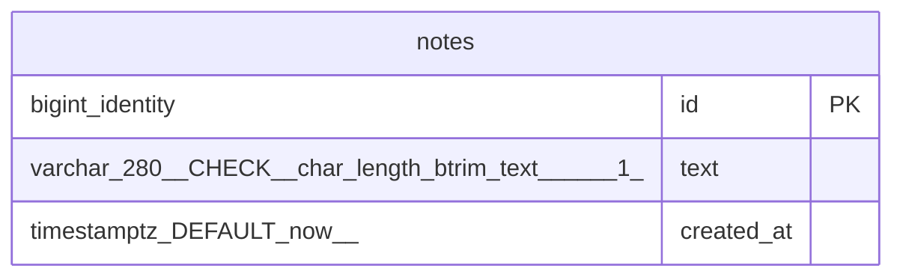

# Data Model

<!-- sdlc:auto:start entities -->
### notes

| Field | Type | PK | FK | Nullable |
|---|---|---|---|---|
| id | bigint identity | True | — | False |
| text | varchar(280) CHECK (char_length(btrim(text)) >= 1) | False | — | False |
| created_at | timestamptz DEFAULT now() | False | — | False |
<!-- sdlc:auto:end entities -->

<!-- sdlc:auto:start relationships -->
_No relationships recorded._
<!-- sdlc:auto:end relationships -->

<!-- sdlc:auto:start er-diagram -->

<!-- sdlc:auto:end er-diagram -->
