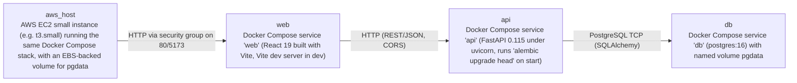

# Deployment Guide

> Maintained by QuorQ AI SDLC. Text between `sdlc:auto` markers is regenerated; anything outside them is yours and is kept.

<!-- sdlc:auto:start how-it-deploys -->
Pushes to `main` run `.github/workflows/deploy.yml`, which builds the API image (if there is a backend) and deploys the SPA to AWS Amplify. Commits touching only `docs/sdlc/**` don't deploy. Deployments can also be started from the platform's Deployment tab.
<!-- sdlc:auto:end how-it-deploys -->

<!-- sdlc:auto:start environments -->
| Name | Service | Runtime | Scaling | Environment |
|---|---|---|---|---|
| web | Docker Compose service 'web' (React 19 built with Vite, Vite dev server in dev) | Node 20 container, port 5173 | single instance | dev |
| api | Docker Compose service 'api' (FastAPI 0.115 under uvicorn, runs 'alembic upgrade head' on start) | Python 3.12 container, port 8000 | single instance | dev |
| db | Docker Compose service 'db' (postgres:16) with named volume pgdata | PostgreSQL 16 container, port 5432 internal only | single instance, persistent volume | dev |
| aws_host | AWS EC2 small instance (e.g. t3.small) running the same Docker Compose stack, with an EBS-backed volume for pgdata | Amazon Linux with Docker and Docker Compose | single small instance (NFR-009) | dev |
<!-- sdlc:auto:end environments -->

<!-- sdlc:auto:start live -->
**Frontend URL:** https://p171ec6182f4b.d13el1ykvx8z63.amplifyapp.com

**Backend URL:** https://100-52-98-41.sslip.io/apps/171ec6182f4b/

**Database:** PostgreSQL · app

**Version:** 922eb33eae0e

**Commit:** `922eb33`

**Finished:** 2026-10-28
<!-- sdlc:auto:end live -->

<!-- sdlc:auto:start topology -->

<!-- sdlc:auto:end topology -->
